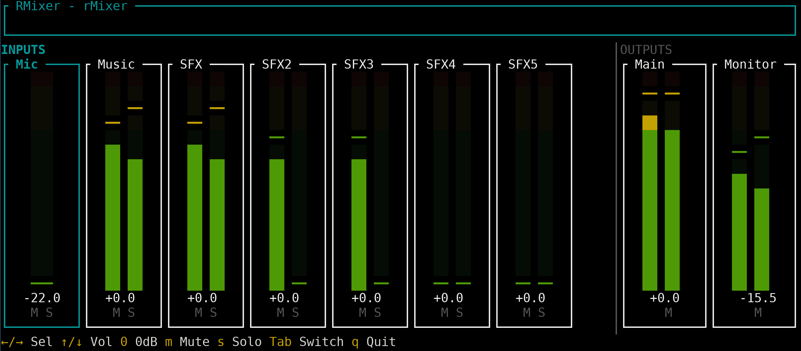

# RMixer - JACK Audio Mixer

A low-latency audio mixer application for JACK with a terminal user interface. Written in Rust.



## Features

- **Configurable Ports**: Define input and output ports in YAML format
- **Real-time Level Meters**: Visual dB level indicators with green/yellow/red zones
  - Green: < -12 dB
  - Yellow: -12 dB to 0 dB
  - Red: ≥ 0 dB (clipping)
- **5-Second Peak Hold**: Visual peak indicators with decay
- **Volume Control**: -60 dB to +12 dB range with 0.5 dB steps
- **Mute & Solo**: Per-channel mute and additive solo (inputs only)
- **Mono/Stereo Support**: Channels can be mono (1 port) or stereo (2 ports)
- **Volume Persistence**: Volume levels are saved to config file on exit
- **Manual Connections**: Ports are exposed for manual connection via `jack_connect`, `qjackctl`, etc.
- **Control API**: Optional HTTP + JSON API for reading and changing volume, mute and solo

## Requirements

### Build Dependencies

```bash
# Debian/Ubuntu
sudo apt install build-essential libjack-jackd2-dev libclang-dev

# Fedora
sudo dnf install gcc jack-audio-connection-kit-devel clang-devel

# Arch
sudo pacman -S base-devel jack2 clang

# NixOS
# Dependencies are handled automatically via the Makefile
```

### Runtime Dependencies

- JACK server (running via `jackd`, `pipewire-jack`, or similar)

## Building

```bash
make build        # Debug build
make release      # Release build
```

Or directly with cargo (non-NixOS):

```bash
cargo build --release
```

## Usage

```bash
rmixer --config config.yaml
```

### Command Line Options

- `-c, --config <PATH>`: Path to configuration file (required)
- `--api-listen [<ADDR>]`: Enable the [control API](#control-api). Off by default
- `--api-key <KEY>`: Key that API clients must send. Required when the API is enabled
- `-v, --verbose`: Enable verbose logging
- `-h, --help`: Print help
- `-V, --version`: Print version

## Configuration

Configuration is done via a YAML file. See `config.example.yaml` for a full example.

```yaml
# JACK client name
client_name: "Mixer"

# Input channels to mix
inputs:
  - name: "Mic"           # Display name
    ports:
      - "mic_in"          # Mono: single port

  - name: "Music"
    ports:
      - "music_in_L"      # Stereo: two ports
      - "music_in_R"

# Output channels (receive sum of all inputs)
outputs:
  - name: "Main"
    ports:
      - "main_out_L"
      - "main_out_R"
```

Ports are exposed as `{client_name}:{port_name}`, e.g., `Mixer:mic_in`.

Volume levels are automatically saved to the config file on exit and restored on next startup:

```yaml
inputs:
  - name: "Mic"
    ports:
      - "mic_in"
    volume_db: -6.0       # Optional: saved volume level
```

To enable the [control API](#control-api) from the config file, add a listen address:

```yaml
api_listen: "127.0.0.1:7700"
```

The API key cannot be set in the config file: pass it with `--api-key`.

## Controls

| Key | Action |
|-----|--------|
| `←` / `→` | Select channel |
| `↑` / `↓` | Adjust volume (±0.5 dB) |
| `0` | Reset volume to 0 dB |
| `m` | Toggle mute |
| `s` | Toggle solo (inputs only) |
| `Tab` | Switch between inputs/outputs |
| `q` / `Esc` | Quit |

## Connecting Ports

RMixer does not auto-connect ports. Use external tools to make connections:

```bash
# List available ports
jack_lsp

# Connect ports
jack_connect "Mixer:mic_in" "system:capture_1"
jack_connect "Mixer:main_out_L" "system:playback_1"
jack_connect "Mixer:main_out_R" "system:playback_2"
```

Or use graphical tools like `qjackctl`, `qpwgraph`, or `helvum`.

## Control API

External clients can read and change channel settings over HTTP while the TUI is running. Changes from the API and the keyboard act on the same state, so the TUI shows API changes on the next frame, and volumes changed through the API are saved to the config file on exit like any others.

The API runs inside the `rmixer` process and exits with it. It is off by default. Enable it with `--api-listen` or with `api_listen` in the config file; the command line takes precedence and is not written to the config file. Either way, you must also give an API key:

```bash
rmixer --config config.yaml --api-listen --api-key "$RMIXER_API_KEY"
```

| Value | Listens on |
|-------|------------|
| `--api-listen` with no value | `127.0.0.1:7700` |
| `PORT`, e.g. `8000` | `127.0.0.1:PORT` |
| `IP:PORT`, e.g. `[::1]:8000` | That address |

Host names are not accepted. With the API enabled, names must be unique within the inputs and within the outputs, because channels are addressed by name; rmixer refuses to start otherwise. rmixer also refuses to start if the address cannot be bound, if the API is enabled without a key or with an empty one, or if `--api-key` is given without the API being enabled.

### Security

**An API key is required.** Every request must carry the key the instance was started with, in the header `Authorization: Bearer <key>`, including read-only requests and requests from loopback. There is no query parameter form. Use a long random value of printable ASCII characters, such as the output of `openssl rand -hex 32`: anyone with the key can change the mixer, including raising a channel to +12 dB.

**Traffic is not encrypted.** The API speaks plain HTTP, so the key and all requests can be read by anything that can see the traffic. The API listens on loopback unless you choose otherwise. Binding any other address, such as `0.0.0.0:7700`, sends the key over the network in the clear, and rmixer prints a warning at startup when you do. On untrusted networks, put a TLS proxy or VPN in front of the API.

**A key on the command line is not private.** Other local users can see it in the process list, for example with `ps`, and it may land in your shell history. On a shared machine, assume that local users can learn the key.

The key is never written to the config file or to logs.

### Endpoints

| Method | Path | Purpose |
|--------|------|---------|
| `GET` | `/api/v1/state` | All channels: name, port count, volume, mute, solo |
| `PATCH` | `/api/v1/inputs/{name}` | Update any of `volume_db`, `volume_delta_db`, `muted`, `soloed` |
| `PATCH` | `/api/v1/outputs/{name}` | Update any of `volume_db`, `volume_delta_db`, `muted` |

Names are case-sensitive and must be percent-encoded in the path where needed, e.g. `Lead%20Vocal`.

```bash
$ curl http://127.0.0.1:7700/api/v1/state \
    -H "Authorization: Bearer $RMIXER_API_KEY"
{"inputs":[{"name":"Mic","port_count":1,"volume_db":-6.0,"muted":false,"soloed":false}],
 "outputs":[{"name":"Main","port_count":2,"volume_db":0.0,"muted":false}]}

$ curl -X PATCH http://127.0.0.1:7700/api/v1/inputs/Mic \
    -H "Authorization: Bearer $RMIXER_API_KEY" \
    -H 'Content-Type: application/json' \
    -d '{"volume_db": -6.0}'
{"name":"Mic","port_count":1,"volume_db":-6.0,"muted":false,"soloed":false}
```

(Output of the first command is wrapped here for readability.)

Fields of a `PATCH` request:

| Field | Type | Meaning |
|-------|------|---------|
| `volume_db` | number | Set the volume. Clamped to -60 to +12 dB |
| `volume_delta_db` | number | Change the volume relative to its current value, e.g. from a rotary encoder. The result is clamped to the same range |
| `muted` | boolean | Set mute |
| `soloed` | boolean | Set solo. Inputs only |

At least one field is required, and `volume_db` and `volume_delta_db` cannot be combined. A request is applied as a whole or not at all. The response is the channel state actually applied, so it shows the clamped volume. Outputs have no `soloed` field.

Errors have a JSON body of the form `{"error": "..."}`:

| Status | Meaning |
|--------|---------|
| `400` | Invalid request, including `soloed` on an output and unknown fields. Nothing was changed |
| `401` | Missing or wrong API key. Sent with `WWW-Authenticate: Bearer`, before the request body is read. Nothing was changed |
| `404` | Unknown channel or path |
| `405` | Wrong method for this path |
| `413` | Request body too large |
| `503` | The control queue is full, or rmixer is shutting down. Nothing was changed; a full queue is usually temporary, so the request can be retried |

Meter data is not available through the API, and mute and solo are not persisted.

## Architecture

```
┌─────────────────────┐     meters (rtrb)     ┌─────────────────────┐
│    Audio Thread     │──────────────────────►│     UI Thread       │
│                     │                       │                     │
│  JACK Process       │                       │  ratatui + crossterm│
│  Callback           │                       │  Event handling     │
│  Level metering     │                       │  Rendering          │
│                     │                       └──────────┬──────────┘
│                     │                                  │ mutex
│                     │    control (rtrb)     ┌──────────▼──────────┐
│                     │◄──────────────────────│     Mixer Core      │
│                     │                       │  Volume, mute, solo │
└─────────────────────┘                       └──────────▲──────────┘
                                                         │ mutex
                                              ┌──────────┴──────────┐
                                              │     API Thread      │
                                              │  Optional, HTTP     │
                                              └─────────────────────┘
```

- **Mixer core**: The single source of truth for volume, mute and solo. The TUI and the API act on it through the same operations, and it alone sends control messages. The audio thread never touches it or its lock
- **Absolute control messages**: Messages carry the value to set, and are queued in the same order as the changes to the core, so the audio thread stays in step with it. If a change does not fit in the queue, the core is left as it was
- **Lock-free communication** via `rtrb` ring buffers
- **Real-time safe** audio processing (no allocations in audio callback)
- **Synchronized I/O**: Single JACK process callback handles all inputs and outputs
- **60 FPS** UI refresh rate

## License

MIT
